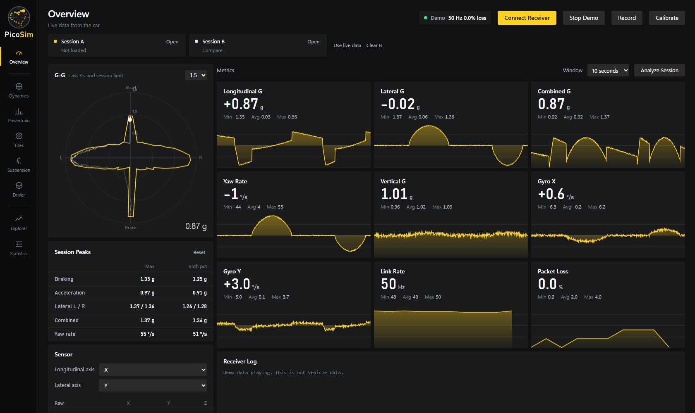
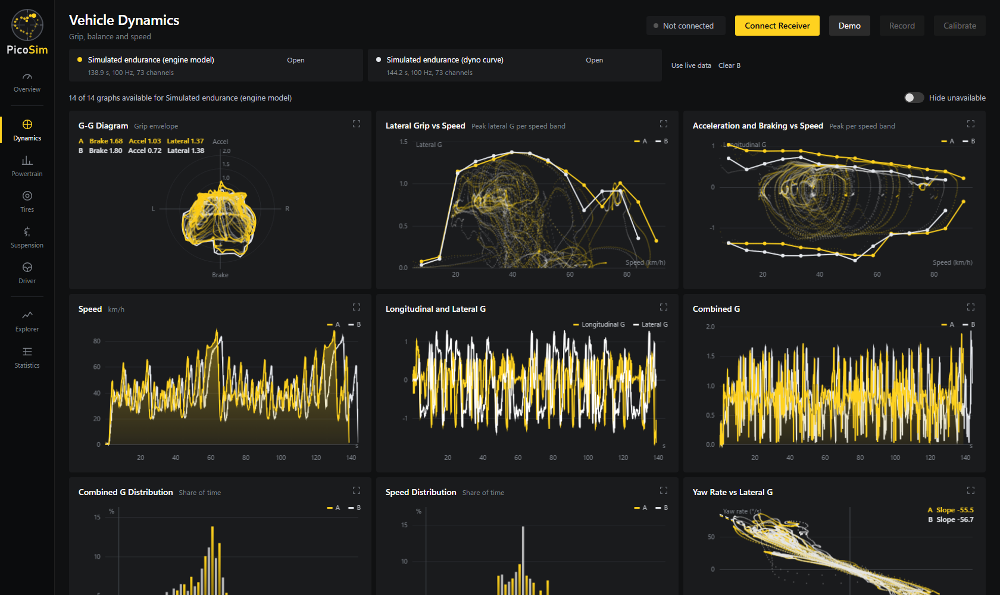
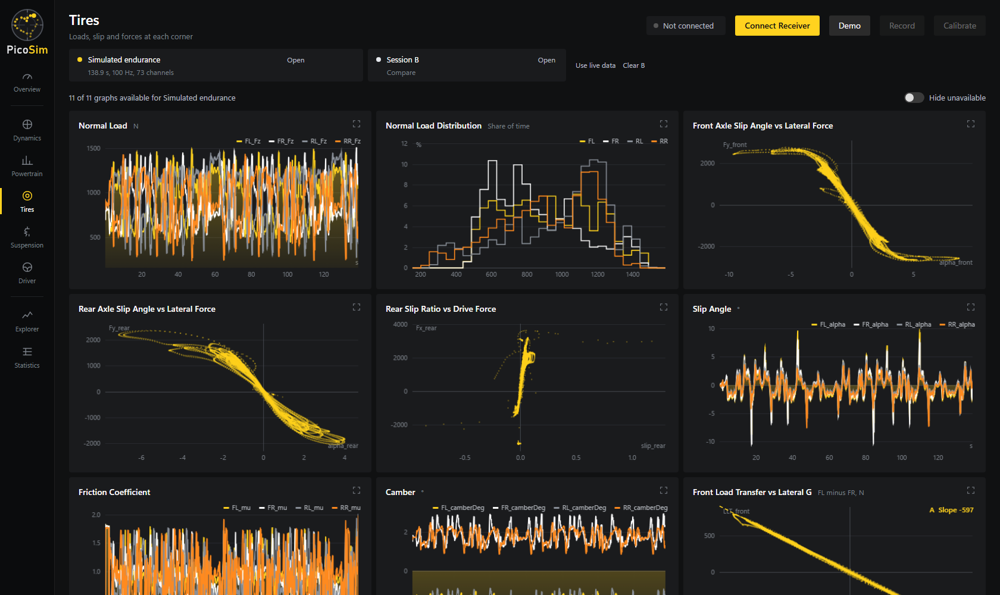

# PicoSim Telemetry

On-car data logging and browser-based analysis for a Formula Student car, built so that real runs and
[PicoSim](https://gkn68.github.io/simulator.html) simulator runs can be compared directly.

**Try it:** [live demo](https://gkn68.github.io/app/telemetry.html?demo=1) (synthetic data, runs in the browser)



## What's here

| Folder | Contents |
|---|---|
| `app/` | The telemetry and analysis app. A single HTML file with no install and no internet connection needed. |
| `firmware/Car_Telemetry/` | ESP32 on-car unit: reads the IMU and sends packets to the pits at 50 Hz. |
| `firmware/Pit_Receiver/` | ESP32 pit unit: receives packets and streams them to the laptop over USB. |
| `docs/` | Screenshots. |

## The app

Open `app/index.html` in Chrome or Edge.

- **Overview**: live G-G diagram with the session grip limit, peak and 95th-percentile values, and a graph for every channel.
- **Graph library**: 52 predefined engineering graphs on five pages (Vehicle Dynamics, Powertrain, Tires,
  Suspension & Aero, Steering & Driver). They are drawn as soon as a log is opened, and graphs that need a
  channel the log does not have are marked.
- **Two sessions at once**: open any two logs (car vs simulator, setup A vs setup B) and every graph overlays them.
- **Explorer** and **Statistics** for any channel.
- **Recording**: saves the live stream as CSV.

URL options: `?demo=1` starts the demo, `?a=log.csv&b=other.csv&page=vd` opens logs and a page directly.

| Vehicle Dynamics | Tires |
|---|---|
|  |  |

## Hardware

- ESP32 boards (on-car unit and pit receiver)
- BMI270 IMU on its own SPI bus
- 2.4 GHz radio link between car and pits
- Planned: GPS, suspension position, wheel speed and ECU data over CAN, SD logging

Pin assignments are listed at the top of each sketch.
Libraries: RF24 (TMRh20), SparkFun BMI270 Arduino Library.

## Serial format (pit receiver → laptop, 115200 baud)

```
D,<rx_ms>,<packet_no>,<car_ms>,<ax>,<ay>,<az>,<gx>,<gy>,<gz>   accelerations in g, rates in deg/s
S,<packets_per_s>,<lost>                                       link status, once per second
# <text>                                                       messages
```

## Status

Working: IMU and radio link, analysis app with recording, calibration and demo mode.
Next: CAN, GPS, suspension and wheel-speed channels, SD logging, log format matched to the simulator.
